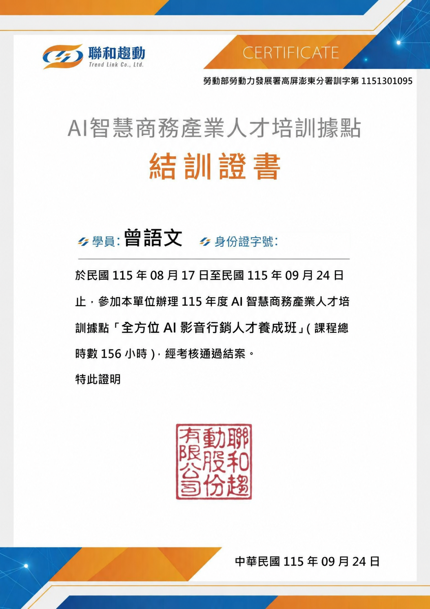
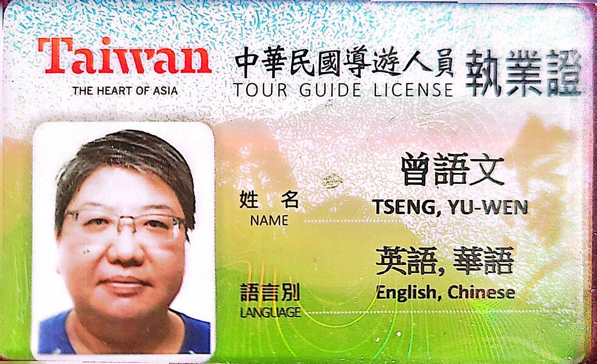

  

<h1 align="center">Yuwen AI Studio</h1>

  <strong>AI Video Creator × English Education × Taiwan Travel</strong> 
  <em>Explore Taiwan with AI & a Smile!</em>

  <a href="yuwen-resume-responsive.html"><strong>View Interactive Resume</strong></a>
  &nbsp;•&nbsp;
  <a href="yuwen-resume-a4-portfolio.html"><strong>View Portfolio Resume</strong></a>
  &nbsp;•&nbsp;
  <a href="https://github.com/yuwen067099-cmd/yuwen-ai-search-lab"><strong>AI Project Lab</strong></a>

---

## 👋 About Yuwen

我是 **曾語文 Yuwen Tseng**，目前專注於把 **AI 影音、英語教學、台灣旅遊與個人品牌內容** 結合成可實際應用的作品。

我的經歷橫跨：

- International Business & Overseas Communication
- Licensed Tour Guide & Tour Leader
- Occupational Safety & EHS
- Digital Content & Social Media
- AI Video Production
- English Learning Content

我希望把複雜資訊轉化成 **清楚、好懂、好看、可以直接使用的影音內容**。

---

## 🎬 Featured Portfolio

### Yuwen Interactive Resume｜MV60

**60-second personal brand story**

International Business → Tourism → Digital Marketing → AI Video → Personal Brand

**Focus:** 讓面試官或合作對象在短時間內理解我的跨領域能力與創作方向。

---

### Yuwen Daily Funny English｜MV30

以 **Yuwen＋橘貓** 為固定角色的生活英文短影音系列。

- 30 秒直式 Short-form Video
- 3-second Hook
- One practical English phrase per episode
- Funny orange-cat mistake
- Yuwen correction
- Taiwan daily-life setting
- AI animation + English learning

**Core idea:** Learn English through story, humor and repetition.

---

### Taiwan Travel × AI

將台灣旅遊導覽、地方文化與 AI 影像製作結合：

- Taiwan attractions
- Local culture
- Travel English
- Tour guide storytelling
- AI-generated short videos
- Multilingual subtitle design

---

### AI English Education

AI 動畫英語教學內容方向：

- English Grammar
- Daily Conversation
- Vocabulary Stories
- Five Basic Sentence Patterns
- Elementary & Junior High English
- AI Animated Lessons

---

## 🖼️ Visual Credentials

  
  

These materials support my background in **AI training and professional tourism**.

---

## 🧰 Creative Workflow

**Idea → Script → Storyboard → Image → Animation → Voice → Subtitle → Short Video**

Tools I commonly use:

`ChatGPT` · `Gemini` · `Canva` · `CapCut` · `Kling` · `Runway` · `Midjourney` · `Flux`

---

## 💼 Yuwen AI Studio Services

可發展與提供的內容製作服務：

| Service | Deliverable |
|---|---|
| AI Short Video | 30s / 60s Reels & Shorts |
| AI English Animation | Grammar / Vocabulary / Conversation |
| Taiwan Travel Video | Destination & storytelling video |
| Interactive Resume | Personal brand / job-search video |
| Storyboard Design | Shot list + AI prompts |
| AI Music Video | Song concept + short-form visual |
| Social Content | Script + subtitles + short video concept |

---

## 📄 Resume Center

### Interactive
- [Responsive Interactive Resume](yuwen-resume-responsive.html)

### A4 Versions
- [Business Resume](yuwen-resume-a4-business.html)
- [Editorial Resume](yuwen-resume-a4-editorial.html)
- [Executive Resume](yuwen-resume-a4-executive.html)
- [Portfolio Resume](yuwen-resume-a4-portfolio.html)

---

## 🚀 Project Links

- [Yuwen Resume Repository](https://github.com/yuwen067099-cmd/yuwen-resume)
- [Yuwen AI Search Lab](https://github.com/yuwen067099-cmd/yuwen-ai-search-lab)
- YouTube Showcase — link to be added
- Yuwen Travel Website — link to be added

> 這兩個外部連結目前 Repository 裡沒有正式網址，因此先保留位置，避免放錯連結。

---

## 🌏 Brand Vision

**Travel becomes a story.**  
**English becomes easier.**  
**Ideas become videos.**

  <strong>Yuwen AI Studio</strong> 
  AI Video • English Education • Taiwan Travel

  <strong>Yuwen｜Explore Taiwan with AI & a Smile!</strong>

